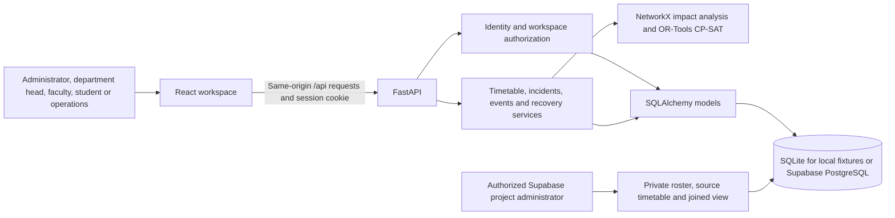
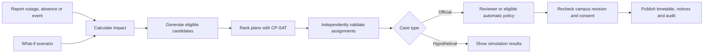

# OMNIS-X architecture

OMNIS-X uses a React client, a FastAPI service and a relational database. Server-side authorization, impact calculation and publication keep the same rules in effect across dashboards, timetables and recovery views.

## System context

- **Browser.** React Router selects the workspace. TanStack Query loads the role-scoped dashboard, resources, timetable and notifications, then polls workspace data every five seconds and refreshes it after mutations. The client shows an interrupted-refresh state when a previous snapshot is available.
- **Delivery.** In a built application, FastAPI serves the SPA and hashed assets. The HTML entry point uses `Cache-Control: no-cache`. On a lazy-load failure the client attempts one reload per build and provides a retry button if the view still cannot load. During development Vite proxies `/api` to FastAPI.
- **Service.** FastAPI validates inputs with Pydantic and checks authentication and resource scope on the server. Database work uses a request-scoped SQLAlchemy session. A successful write response follows the commit.
- **Persistence.** SQLite creates its operational schema automatically and enables foreign keys and WAL. Supabase uses the pre-provisioned private `omnisx` schema, a dedicated database login and verified TLS for hosted connections.

## Role and timetable boundaries

| Identity | Scope |
| --- | --- |
| Admin | Institution-wide timetables, resources, accounts, official incidents and audit. Can edit policy and approve valid current plans. |
| HOD | Department-scoped schedule, digital twin, incidents and recovery. Reviews departmental leave and events. HOD publication requires delegated approval and administrator review for plans that change to another department's room. |
| Faculty | Own timetable and assigned teaching or consent activity. Staff bookings are available in the read-only campus toggle. Absences use the authenticated faculty ID and room reports require a matching scheduled room and interval. |
| Student | Department and cohort determine eligible sessions. A batch sees common classes plus its own lab assignments. An explicit registration list further restricts course visibility. Notifications are scoped to the account. |
| Operator | Institution-wide operational visibility, infrastructure reporting, simulations and plan recommendations. |

The timetable stores each published occurrence as a dated session. Week view starts on Monday. The same role scope applies to Day, Week and List. In Digital twin, **Resources** groups searchable resources and shows direct dependencies. **Graph** draws the scoped nodes and directed connections. The views share the selected date, filters and resource. A scenario uses the hypothetical incident and its impact as the model context.

## Data model

| Records | Purpose and relationships |
| --- | --- |
| `resources`, `resource_dependencies` | Departments, faculty, buildings, power and network resources, rooms, labs and cohorts. Directed dependency edges go from a required resource to the resource that uses it. A section can contain disjoint lab batches. |
| `academic_sessions` | Each occurrence stores course, date, start, duration, room, instructor, cohort, type, requirements and publication status. A change can retain the preceding assignment in `previous`. |
| `users`, `account_profiles`, `student_enrollments`, `auth_sessions` | Portal identities, department links, profile and registration scope, credential hashes and revocable sessions. |
| `incidents`, `recovery_plans`, `substitution_requests` | Official and simulated cases, ranked proposals at a campus revision, and faculty consent decisions. |
| `college_events`, `leave_requests` | Scope-aware event reservations and faculty leave review. Approved leave can become an availability incident. |
| `institution_state`, `notifications`, `audit_logs` | Timetable version, coordination revision and policy. Publication creates scoped notifications and an audit record. |
| `omnisx.student_roster`, `omnisx.timetable_reference_pages`, `omnisx.student_timetable` | Connected-project source records, separate from portal authentication. The cohort-linked roster view reads published sessions. PDFs are represented as structured reference rows rather than duplicated into each student's timetable. |

The six-section source PDF is the Bapuji Institute of Engineering & Technology timetable for CSE Semester V, odd semester 2026–2027, dated September 15, 2026. The portal fixture uses the IIET demo identity and modeled faculty, facilities and constraints. Solver attendance and workload constraints use resource data. The imported roster is restricted to project administration and is independent of teaching capacity, account provisioning and student registration records. The source grid identifies PEC and AEC periods. Individual allocations require the separate PEC and AEC documents.

### Time and publication

Dates are ISO calendar dates and teaching times are integer minutes after midnight. Intervals are half-open. Events can span multiple dates and reuse the same time window each day. Audit timestamps use UTC. The portal's today value comes from the backend host clock.

The institution **revision** guards decisions against concurrent changes to the plan's inputs. The **timetable version** tracks a published schedule change. Official writes that participate in recovery take a compare-and-swap on the revision. Publication and its timetable edits, plan state, incident state, notices and audit record share one transaction.

## Recovery pipeline

1. Intersect resource downtime or an event reservation with scheduled sessions. NetworkX follows mandatory dependencies from the incident roots. Expand impacted cohorts to leaf batches before counting students so shared sections and batches do not double-count.
2. Generate candidate room, faculty and time assignments. Check qualifications, substitution policy, calendars, room type, capacity, equipment, current outages, resource reservations and fixed bookings. Same-day start times are searched on a half-hour grid. Faculty absence and event recovery can include later teaching days within the modeled horizon. Protected sessions retain their original date and time.
3. CP-SAT prioritizes the number of recovered sessions, then minimizes weighted student-minutes delayed, room changes and instructor substitutions. The solver uses an eight-second search budget and can generate up to three distinct solutions internally. The service ranks and exposes up to two alternatives. For a recoverable IIET demo case it displays the best plan and a class-free option. Supported faculty absences can also consider a validated same-section slot swap that preserves both instructors.
4. An independent validator checks preserved duration, modeled intervals, workload, consecutive teaching, travel, protected slots and remaining clashes. Plans carry their actual solver status and unresolved-session details.
5. Manual mode waits for plan generation. Assisted mode generates plans for review. Automatic mode can apply a complete plan with zero delay, zero substitutions and a penalty within policy. Optional faculty consent is checked at approval for changes to instructors.
6. Approval validates the latest revision and timetable. Uncovered sessions are marked unresolved, and affected portal accounts receive a timetable update or cancellation notice. The original and revised assignments remain available for comparison.

Scenario Lab creates flagged hypothetical cases and stores their proposals for comparison. Official outage calculations, timetable versions and notifications follow the actual campus state.

## Date-scoped resilience

The staff dashboard fetches resilience for the selected date. **Inspect** opens Analytics with that date. The score is the rounded arithmetic mean of the available factor scores on a 0–100 scale.

| Factor | Measurement |
| --- | --- |
| Room redundancy | Share of active sessions with at least two inventory rooms that meet type, capacity and equipment requirements. |
| Qualified backup | Share of active sessions with another subject-qualified instructor in the department. |
| Schedule compliance | Share of scheduled sessions free from modeled room, booking, workload and outage violations, event clashes and unresolved assignments. |
| Recovery success | Recovered cases divided by the date's visible cases in the Recovered, Partial recovery or Needs intervention states. |
| Independent power | Share of modeled teaching spaces in use with more than one upstream power source, among those with at least one modeled supply. |

Unmeasured factors are omitted and an entirely unmeasured date shows an empty state. Two dates can have the same rounded score even when their session counts differ. The score is a diagnostic of recorded schedules and modeled resources. The recovery validator checks whether an inventory backup is feasible for the actual time.

## Security and operating scope

Passwords use Argon2. Random session tokens are stored as SHA-256 digests. The browser receives an HTTP-only, SameSite=Strict cookie with an eight-hour regular session or a seven-day remembered session. In non-demo mode the cookie is Secure. Password reset revokes the account's prior sessions. Writes check the request origin, and normal access checks run again on every protected API call.

The operational Supabase tables use row-level security and database grants for the backend's application role. The private roster and source tables use row-level security and project-administrator access. The roster view runs with the caller's permissions. The browser consumes FastAPI endpoints and the project credential stays in the backend environment.

The architecture is implemented in the [API and auth routes](../backend/app/main.py), [database models](../backend/app/database.py), [recovery services](../backend/app/services.py), [optimizer](../backend/app/engine/optimizer.py), [validation](../backend/app/engine/validation.py) and [analytics](../backend/app/analytics.py).

